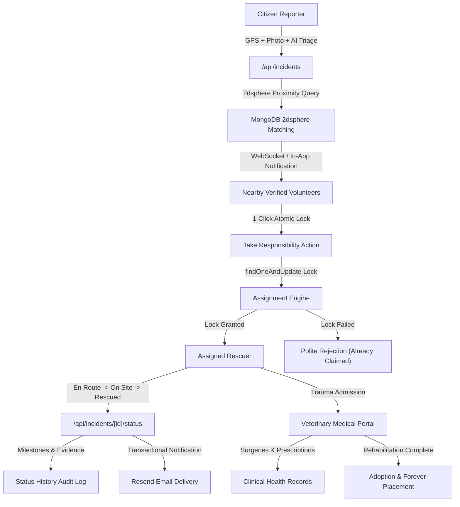

# 🐾 POWER ALERT
### Production-Ready Animal Rescue & Welfare Management Platform
> *"Every Life Matters. Every Alert Counts."*

[](https://nextjs.org/)
[](https://www.typescriptlang.org/)
[](https://tailwindcss.com/)
[](https://www.mongodb.com/)
[]()

---

## 🌟 1. Executive Summary & Product Vision

**POWER ALERT** is a modern, scalable, production-oriented animal rescue and welfare management platform designed for animal welfare NGOs, volunteer networks, veterinarians, shelters, and citizens.

Unlike static websites or placeholder dashboards, **POWER ALERT** connects citizens reporting animals in distress directly with nearby field rescuers through an **atomic, high-concurrency assignment workflow ("Take Responsibility")**, MongoDB 2dsphere geospatial matching, live 12-milestone status tracking, automated transactional emails via Resend, AI injury triage, community feeding zone management, and 80G tax-deductible donation handling.

---

## 🏛️ 2. Architectural Blueprint



---

## 💻 3. Technology Stack

- **Frontend Framework**: Next.js 14 App Router, React 18, TypeScript.
- **Styling & Aesthetics**: Tailwind CSS with custom warm cream, soft lavender, mint, and peach pastel palettes, subtle shadows, rounded cards (`rounded-3xl`), and paw-print motifs.
- **Animations**: Anime.js for floating illustrations, animated counter numbers, and paw stamps with reduced-motion compliance.
- **Database & ODM**: MongoDB with Mongoose ODM, GeoJSON `Point` coordinates `[longitude, latitude]`, and `2dsphere` indexes.
- **Authentication & Security**: Argon2id/Bcrypt password hashing, JWT session cookies (httpOnly, sameSite lax), role-based middleware authorization.
- **Email Delivery**: Resend integration + responsive React Email-styled HTML templates with instant mock mode and database logging.
- **Geographical Visualization**: Leaflet & OpenStreetMap interactive map with custom color-coded category and priority pins.
- **AI Triage**: Automated injury severity triage, emergency priority suggestion, and duplicate incident detection.

---

## 👥 4. User Roles & Permission Matrix

| Role | Access Permissions | Default Dashboard |
| :--- | :--- | :--- |
| **PUBLIC_USER** | Report distressed animals, track submitted cases, adopt pets, donate, report missing animals. | `/user/dashboard` |
| **RESCUE_VOLUNTEER** | Accept open rescue cases, update rescue progression (en route, reached, rescued), upload evidence. | `/volunteer/dashboard` |
| **MEDICAL_VOLUNTEER**| Administer first-aid, coordinate vet transport, log medical observations. | `/volunteer/dashboard` |
| **FOOD_VOLUNTEER**   | Manage feeding zones, replenish water points, log daily feeding quantities. | `/volunteer/feeding` |
| **SHELTER_VOLUNTEER**| Animal enrichment, sanctuary maintenance, foster intake. | `/volunteer/dashboard` |
| **VETERINARIAN**     | Clinical exams, surgical records, prescription logs, follow-up management. | `/vet/dashboard` |
| **NGO_ADMIN**        | Fleet oversight, volunteer verification, shelter capacity, adoption review, financial reports. | `/ngo/dashboard` |
| **SUPER_ADMIN**      | Cross-NGO monitoring, system analytics, audit logs, email deliverability logs. | `/admin/dashboard` |

---

## ⚡ 5. High-Concurrency "Take Responsibility" Engine

In traditional welfare groups, double-handling or abandoned cases frequently occur. **POWER ALERT** solves this with an atomic database lock:

```typescript
// Atomically locks assignment to the first rescuer to accept
const updatedIncident = await Incident.findOneAndUpdate(
  {
    _id: incidentId,
    assignedVolunteerId: null, // Lock condition
    status: { $in: ["REPORTED", "VERIFICATION_PENDING", "VERIFIED"] },
  },
  {
    $set: {
      assignedVolunteerId: volunteer._id,
      assignedAt: now,
      acceptedAt: now,
      status: "VOLUNTEER_ASSIGNED",
    },
    $push: {
      statusHistory: {
        status: "VOLUNTEER_ASSIGNED",
        timestamp: now,
        updatedBy: volunteer._id,
        notes: `Volunteer ${volunteer.fullName} accepted responsibility.`,
      },
    },
  },
  { new: true }
);
```

If multiple volunteers click "Take Responsibility" simultaneously, MongoDB's atomic document locking ensures **exactly one succeeds**, while subsequent requests receive a polite notification that the case has already been safely claimed.

---

## 📢 6. 12-Milestone Rescue Tracking Lifecycle

1. `REPORTED` - Distress report submitted with GPS and photographic evidence.
2. `VERIFICATION_PENDING` - Initial intake triage.
3. `VERIFIED` - Confirmed by regional coordinator.
4. `VOLUNTEER_ASSIGNED` - Rescuer accepts responsibility.
5. `VOLUNTEER_EN_ROUTE` - Rescuer is actively driving/navigating to coordinates.
6. `VOLUNTEER_REACHED` - Rescuer arrives on-site.
7. `RESCUE_IN_PROGRESS` - Safe capture, restraint, and trauma first-aid.
8. `ANIMAL_RESCUED` - Animal secured in vehicle/ambulance.
9. `TREATMENT_STARTED` - Admitted to veterinary trauma center.
10. `RECOVERY_MONITORING` - Inpatient sanctuary observation.
11. `RESOLVED` - Healed, reunited, or fostered.
12. `UNABLE_TO_COMPLETE` - Documented alternative outcome with supervisor sign-off.

---

## 🚀 7. Quick Start & Local Execution

### 1. Install Dependencies
```bash
npm install --legacy-peer-deps
```

### 2. Configure Environment Variables
Copy `.env.example` to `.env.local`:
```bash
cp .env.example .env.local
```
*(If no external MongoDB Atlas URI is provided, the platform automatically starts an embedded in-memory MongoDB instance!)*

### 3. Run the Production Test Suite
```bash
npx ts-node --project tsconfig.scripts.json scripts/test-suite.ts
```

### 4. Start the Next.js Development Server
```bash
npm run dev
```
Open **[http://localhost:3000](http://localhost:3000)** in your browser.

---

## 🔑 8. Pre-Seeded Production Accounts

The database comes pre-seeded with authentic operational records and role accounts:

| Role | Email | Password |
| :--- | :--- | :--- |
| **Super Admin** | `admin@poweralert.org` | `password123` |
| **NGO Coordinator** | `ngo@poweralert.org` | `password123` |
| **Rescue Volunteer** | `volunteer@poweralert.org` | `password123` |
| **Veterinarian** | `vet@poweralert.org` | `password123` |
| **Citizen Reporter** | `user@poweralert.org` | `password123` |

*(A 1-click Quick Login switcher is also embedded directly on the `/login` page for seamless testing!)*

---

## 🛡️ 9. Compliance & Security

- **OWASP Recommended Practices**: Parameterized MongoDB queries (NoSQL injection safe).
- **Sensitive Geographical Data**: Public views mask exact residential numbers while preserving street emergency utility.
- **Financial Integrity**: 80G tax exemption receipts generated with unique sequential identifiers (`REC-2026-XXXX`).
- **Resend Verification**: Transactional templates include deliverability tracking, fallback simulators, and permanent MongoDB audit logs.

---
© 2026 POWER ALERT Platform • Developed with compassion for every animal in distress.
